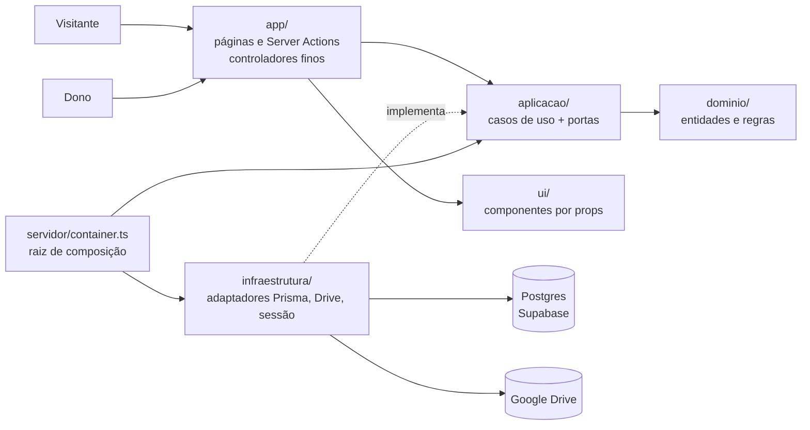

# Arquitetura

Problema: um portfólio com conteúdo variado (projetos, publicações, eventos, experiência) que o dono edita por um painel, e um site público rápido que mostra esse conteúdo com animações.

## Visão geral: Clean Architecture (ADR-0013)

As setas de código só apontam para dentro. Casos de uso falam com portas (interfaces); adaptadores de infraestrutura implementam essas portas.



## Camadas e pastas

```
src/
  dominio/            entidades, value objects, regras e erros de domínio (TypeScript puro, sem I/O)
    projeto/ publicacao/ evento/ experiencia/ perfil/ compartilhado/
  aplicacao/
    casos-de-uso/     um por ação (listarProjetosPublicados, salvarProjeto...), dependências por parâmetro
    portas/           interfaces: ProjetoRepository, DriveClient, Relogio, Sessao...
  infraestrutura/     adaptadores que implementam as portas: Prisma, Google Drive, sessão
  servidor/
    container.ts      raiz de composição: o único lugar que liga portas a adaptadores
  app/                rotas Next.js (site público e /admin), Server Actions e mapeamento resultado → props
  ui/                 design system: tokens, componentes visuais, animações GSAP
tests/
  fakes/              FakeProjetoRepository, FakeRelogio, FakeDriveClient...
  integracao/         adaptadores contra Postgres real (Testcontainers)
  e2e/                Playwright: fluxos do visitante e do painel
```

Regras (detalhes e justificativas no ADR-0013):
- Só se importa para dentro: `dominio` ← `aplicacao` ← `app`/`infraestrutura`. `ui` não importa `aplicacao` nem `infraestrutura`.
- `dominio` e `aplicacao` não conhecem Next, React, Prisma, Zod, GSAP nem nada de I/O.
- Toda dependência externa é uma porta em `aplicacao/portas/`, com adaptador em `infraestrutura/` e fake em `tests/fakes/`.
- Erros esperados voltam como `Resultado`; exceção só para bug.
- Validação de entrada na borda (Server Actions e rotas) com Zod; dentro dos casos de uso os dados já são confiáveis.
- Imposto pelo lint (`no-restricted-paths`) e pelo dependency-cruiser no portão.

## Leitura e escrita de conteúdo

- **Leitura (site público):** página (dentro de `"use cache"` com `cacheTag`) → caso de uso → porta `…Repository` → adaptador Prisma.
- **Escrita (painel):** formulário → Server Action (autenticação + Zod) → caso de uso (autorização + regras) → porta → adaptador → a Server Action chama `updateTag` com as etiquetas que o caso de uso informou.

## Testes

| Camada | Tipo | Ferramenta | Dependências |
|---|---|---|---|
| dominio | unitário | Vitest | nenhuma |
| aplicacao | unitário | Vitest | fakes nomeados |
| infraestrutura | integração | Vitest + Testcontainers | Postgres em Docker, subido pelo próprio teste |
| ui | componente | Vitest + Testing Library | props de exemplo |
| fluxo completo | e2e | Playwright | app rodando com banco de teste |

`pnpm check` roda lint, tipos, arquitetura e unitários sem nenhuma configuração manual.

## Segurança (resumo; detalhes na change do painel)

- Painel com um único usuário dono; senha com argon2; sessão em cookie httpOnly, Secure e SameSite.
- Autorização checada em toda Server Action, não só na interface.
- Limite de tentativas de login; proteção CSRF nativa das Server Actions conferida em teste.
- URLs do Google Drive validadas (só domínios do Google) para evitar SSRF e links maliciosos.
