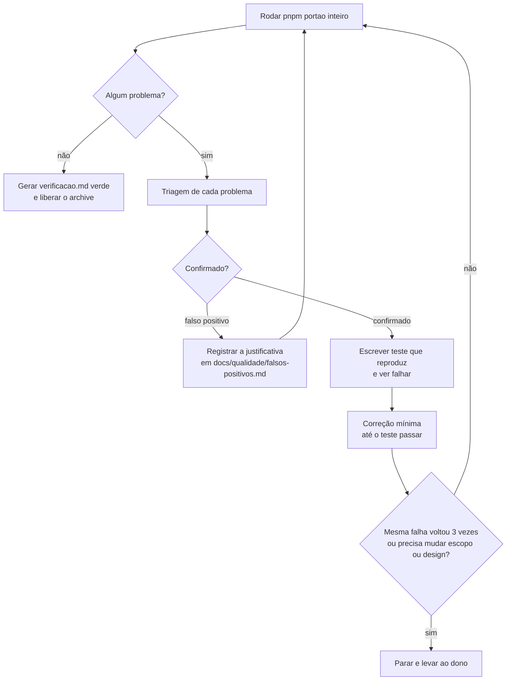

# Estratégia de testes e portão de qualidade

Problema: garantir que nenhuma change seja dada como pronta com teste falhando, spec inválida ou falha de segurança confirmada, sem depender de alguém lembrar de rodar tudo.

Regra: **uma change OpenSpec só é arquivada quando o portão roda inteiro, numa única execução, sem nenhum problema pendente** (ADR-0008). Os testes das changes anteriores fazem parte do portão: tudo que já existe continua verde.

## Os três ritmos

| Ritmo | Quando | O que roda | Duração alvo |
|---|---|---|---|
| Hook | a cada edição de arquivo | testes unitários e de componente relacionados ao arquivo | < 60 s |
| `pnpm check` | durante o desenvolvimento | lint, tipos, arquitetura, unitários, componentes | < 2 min |
| `pnpm portao` | antes de arquivar e em todo push (CI) | tudo o que se aplica à change, incluindo o Mantis | 10 a 20 min + Mantis |

## Os três blocos do portão

1. **Testes e verificações automáticas:** a matriz abaixo.
2. **Validação do OpenSpec:** `openspec validate --strict` da change e de todas as specs.
3. **Revisão de segurança do Mantis:** pipeline do Google Mantis sobre os arquivos alterados na change.
4. **Revisão de qualidade do ponytail:** `/ponytail-review` sobre o diff da change (ADR-0010). Achados "Must fix" e "Should fix" passam pelo ciclo de correção e bloqueiam o portão. Achados "Nice to have" também passam por triagem: são aplicados ou recusados com o motivo registrado no `verificacao.md`. Não ficam sem resposta, mas não reabrem o ciclo sozinhos, porque são opinião de estilo.

## Matriz

Situação: **ativo** desde a change indicada. Antes disso, o relatório mostra "não aplicável" com o motivo, nunca omite.

| Verificação | Ferramenta | Critério de aprovação | Ativo a partir de |
|---|---|---|---|
| Unitários (domínio, casos de uso) | Vitest | 100% passando | 0 |
| Componentes | Vitest + Testing Library | 100% passando | 0 |
| Arquitetura (camadas, ciclos) | ESLint `no-restricted-paths` + dependency-cruiser | zero violações | 0 |
| Lint e formatação | ESLint + Prettier | zero erros | 0 |
| Tipos | `tsc --noEmit` strict | zero erros | 0 |
| Código morto | knip | zero itens | 0 |
| Integração | Vitest + Testcontainers | 100% passando | 0 |
| Ponta a ponta | Playwright (Chromium, Firefox, WebKit) | 100% passando | 0 |
| Smoke | Playwright, subconjunto crítico | 100% passando | 0 |
| Build | `next build` | sem erro | 0 |
| Segredos vazados | gitleaks | zero achados | 0 |
| Dependências vulneráveis | `pnpm audit` | zero altas e críticas | 0 |
| Análise estática de segurança | CodeQL (no CI) | zero alertas | 0 |
| Validação do OpenSpec | `openspec validate --strict` | válido | 0 |
| Mantis | pipeline Mantis (ver abaixo) | zero achados confirmados pendentes | 0 |
| Segurança das skills e hooks do projeto | SkillSpector na pasta `.claude/` | nota ≤ 20 e nenhum achado confirmado pendente | 0 |
| Revisão de qualidade | `/ponytail-review` no diff da change | zero "Must fix" e "Should fix" pendentes; "Nice to have" com decisão registrada | 0 |
| Testes de contrato das portas | Vitest, mesma suíte para cada adaptador (memória agora, Prisma na change 7) | 100% passando em todos os adaptadores | 1 |
| Cobertura | Vitest coverage | ≥ 90% de linhas e ramos em `dominio` e `aplicacao` | 1 |
| Propriedades | fast-check | 100% passando | 1 |
| Mutação | Stryker em `dominio` | ≥ 80% | 1 |
| Migração e banco | Testcontainers | migração aplica do zero e sobre dados; constraints funcionam | 7 |
| Idempotência (seed, escrita repetida) | Vitest integração | 100% passando | 1 |
| Acessibilidade automática | axe-core no Playwright | zero violações | 2 |
| Qualidade de design | `impeccable detect --sarif` (ADR-0015), com as exceções de identidade do ADR da change 2 | zero achados confirmados pendentes | 2 |
| Revisão de design | `/impeccable critique` e `/impeccable audit` nas telas da change | nenhum problema confirmado pendente | 2 |
| Regressão visual | Playwright `toHaveScreenshot` (em contêiner Docker, para não variar por sistema) | zero diferenças fora da tolerância | 2 |
| Movimento reduzido | Playwright `emulateMedia` | nenhuma animação ativa | 2 |
| Teclado e foco | Playwright | todos os controles alcançáveis, foco visível | 2 |
| Responsividade | Playwright em 375, 768 e 1280 px | sem rolagem horizontal, sem sobreposição | 2 |
| Animação | Playwright com relógio controlado + timeline GSAP pausada nos testes | estado inicial e final corretos; nada preso em `opacity: 0` | 2 |
| Hidratação | Playwright lendo o console | zero erros e avisos de hidratação | 3 |
| Lighthouse | Lighthouse CI | Acessibilidade, Boas práticas e SEO = 100; Desempenho ≥ 90 no celular | 3 |
| Tamanho do bundle | size-limit | dentro do orçamento por página | 3 |
| SEO e metadados | Playwright | título, description, Open Graph, sitemap e robots corretos | 3 |
| Links quebrados | lychee | zero links quebrados | 3 |
| Cabeçalhos de segurança | Playwright | CSP, HSTS, `X-Frame-Options`, `Referrer-Policy` presentes | 3 |
| Cache e invalidação | Vitest integração | editar invalida só as etiquetas certas | 7 |
| Autenticação e autorização | Vitest + Playwright | ação protegida sem sessão é recusada no servidor | 8 |
| Limite de tentativas de login | Vitest com relógio falso | bloqueio após o limite | 8 |
| CSRF e injeção | Playwright + Vitest com cargas maliciosas | recusados ou neutralizados | 8 |
| DAST | OWASP ZAP baseline contra o preview | zero alertas médios ou maiores | 8 |
| Validação de URL externa (SSRF) | Vitest | só domínios do Google aceitos | 9 |
| Resiliência de serviço externo | Vitest com `FakeDriveClient` falhando | erro tratado, sem quebrar a página | 9 |
| Smoke pós-deploy e backup | Playwright contra produção + restauração do backup do Supabase | ok | 10 |

**Checklist manual** (você marca no `verificacao.md`; o portão não fecha sem as marcações):

| Item | Ativo a partir de |
|---|---|
| Teste exploratório de 15 minutos | 3 |
| Leitor de tela (NVDA) nas páginas novas | 3 |
| Zoom de 200% | 3 |
| Usabilidade do painel com uma pessoa de fora | 6 |

## Mantis em cada change

- Os skills do Mantis ficam em `~/.agents/skills/mantis-*`. O estado do Mantis (`workspace/`) fica **fora** do repositório, em `../.mantis-estado/`, como o próprio Mantis exige. Nunca é commitado.
- **Primeira execução (change 0):** pipeline completo para criar a base de conhecimento e o modelo de ameaças.
- **Changes seguintes:** modo incremental. O plano do Mantis considera só os arquivos alterados na change e reaproveita o modelo de ameaças.
- **Etapas usadas:** planejamento → pesquisa → deduplicação → revisão (filtra falsos positivos) → crítica (descarta o que não roda em produção) → reprodução (prova com teste) → encadeamento → calibração de risco → relatório.
- A etapa de correção automática do Mantis (`mantis-patch`) **não** é usada. Toda correção passa pelo ciclo de TDD abaixo, para que cada falha confirmada vire um teste de regressão permanente.
- No marco de lançamento (depois da change 10): campanha completa no projeto inteiro.

## Ciclo de correção (até zerar)

Regras do ciclo:
1. **Triagem obrigatória.** Nenhum problema é corrigido nem descartado sem evidência:
   - **Confirmado:** um teste automatizado que reproduz o problema e falha.
   - **Falso positivo:** justificativa escrita com a prova (trecho de código, documentação, execução). Fica registrado em `docs/qualidade/falsos-positivos.md` e é passado ao Mantis como aprendizado, para ele não acusar de novo.
2. **Correção com TDD:** teste de regressão primeiro, depois a menor correção que o faz passar.
3. **Sempre o portão inteiro de novo** depois de cada correção, porque uma correção pode quebrar outra coisa. O portão e o Mantis rodam sem pedir permissão (autorização permanente do dono).
4. **Terminado = uma execução completa sem nenhum item pendente** depois da última correção.
5. **Parar e levar ao dono quando:**
   - A mesma falha voltar depois de 3 tentativas (sinal de design frágil, como diz o `CLAUDE.md`).
   - A correção exigir mudar escopo, spec ou arquitetura.
   - A correção mexer em arquivo fora da change.
   - Houver dúvida se é falso positivo.
6. **Nunca** enfraquecer, apagar ou pular um teste, nem baixar um limite, para o portão passar. Um teste errado é corrigido de propósito, com justificativa.
7. Um teste instável (que às vezes falha) conta como **falha confirmada**: a causa é encontrada e corrigida, não se roda de novo até passar.

## Relatório da change

`pnpm portao` gera `openspec/changes/<change>/verificacao.md` com:
- Cada verificação da matriz: aprovado, reprovado ou não aplicável (com motivo).
- O resultado do Mantis e a lista de falsos positivos aceitos nesta change.
- O checklist manual.
- A data e o commit da execução.

O hook do Claude Code bloqueia o archive (pelo CLI ou movendo a pasta para `openspec/changes/archive/`) se esse relatório não estiver 100% verde e com o checklist manual marcado. Itens manuais ativos que faltarem no `checklist-manual.md` entram como desmarcados.

Revisões externas (`revisoes/<id>.md`): linhas "Commit revisado: <hash>" e "Pendentes: <n>", ou "Não aplicável: <motivo>" quando a ferramenta não se aplica (ex.: ponytail ainda não instalado).
